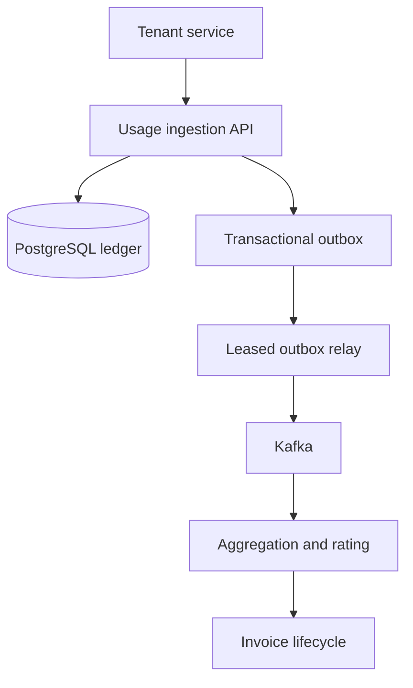

# Usage-Based SaaS Billing Platform

A production-minded Java 17 backend for ingesting, aggregating, rating, and invoicing high-volume SaaS usage. This project focuses on the correctness problems behind billing—tenant isolation, idempotency, immutable ledgers, decimal arithmetic, late events, auditable pricing, and reliable event publication—not a checkout UI.

## Current checkpoint

- Tenant-scoped append-only usage ledger
- Subscription-scoped usage attribution from ingestion through invoicing
- Cross-tenant subscription ownership validation at the API and database layers
- Canonical SHA-256 payload fingerprints
- Exact idempotent replay and `409` conflict behavior
- Active-meter validation and bounded event-time window
- Meter, plan, and graduated price-tier schema
- Transactional `USAGE_RECORDED` outbox
- PostgreSQL `FOR UPDATE SKIP LOCKED` leasing for horizontally scaled relay workers
- At-least-once Kafka publication with stable keys and traceable event headers
- Broker-failure recovery through explicit lease release and expiry
- Durable Kafka inbox deduplication
- Atomic inbox and subscription/hourly event-time aggregation
- Concurrent-safe PostgreSQL bucket upserts
- Tenant-and-subscription-scoped usage-summary API
- Redis-backed current-period usage projection with atomic Lua deduplication
- Fail-closed Kafka/Redis delivery by default, with an explicit degraded-mode switch
- Low-latency tenant-scoped real-time usage API and projection metrics
- Database-backed API keys with public lookup IDs and SHA-256 secret digests
- Constant-time credential verification, expiry, revocation, and least-privilege scopes
- Server-derived tenant identity that overrides spoofed tenant headers
- PostgreSQL 16 Testcontainers coverage for the full Flyway migration chain
- Database-level credential, audit, and cross-tenant constraint verification
- OpenTelemetry HTTP and Kafka tracing with configurable sampling
- OTLP export, trace-aware logs, and sanitized correlation-ID propagation
- Local Jaeger trace exploration through Docker Compose
- AWS deployment foundation with private ECS Fargate tasks, multi-AZ RDS, MSK Serverless, and ElastiCache
- IAM-authenticated Kafka, Secrets Manager injection, autoscaling, rollback, and CloudWatch alarms
- Active subscription and plan resolution
- Deterministic graduated-tier pricing with `BigDecimal`
- Multi-meter rating previews with explicit currency rounding
- Serialized, idempotent billing-period finalization
- Immutable invoices and invoice lines
- Full pricing-tier snapshots for financial auditability
- Transactional `INVOICE_FINALIZED` outbox events
- Idempotent partial credit notes for finalized invoices
- PostgreSQL invoice locking that prevents concurrent over-crediting
- Payload fingerprints detecting conflicting idempotency-key reuse
- Transactional `CREDIT_NOTE_ISSUED` events on a dedicated Kafka topic
- Automatic detection of usage received after invoice finalization
- Immutable late-usage adjustment review queue
- Idempotent adjustment creation and transactional detection events
- Tenant-scoped listing and auditable waiver workflow
- PostgreSQL indexes for meter/time aggregation
- Unit tests for normalization, replay, conflict, and stale events
- Docker Compose for PostgreSQL 16, Kafka, Redis, and Jaeger
- Non-root production container and GitHub Actions verification

## Architecture



The first checkpoint implements the solid-outline ingestion boundary. See [architecture decisions](docs/architecture.md) for trade-offs and the staged roadmap.

The [AWS Terraform stack](infra/terraform/README.md) provides a production-oriented deployment path while keeping local development on Docker Compose.

## Run locally

```bash
docker compose up -d
mvn spring-boot:run -Dspring-boot.run.profiles=local
```

Jaeger is available at `http://localhost:16686`. The application exports OTLP/HTTP traces to `http://localhost:4318/v1/traces`, samples 10% by default, and accepts `TRACING_SAMPLING_PROBABILITY` for environment-specific control. Every HTTP response includes a sanitized `X-Correlation-Id`; callers may supply a safe value containing letters, digits, `.`, `_`, or `-` (maximum 64 characters).

The `local` profile enables an isolated demo-catalog migration; production migrations contain no tenant, credential, or pricing seed data. Use API key `bk_demo.demo-secret` with `api-examples.http` to record usage for the local demo subscription and `demo-tenant/api_calls` meter. The filter validates the hashed credential, derives the tenant, and replaces any caller-provided tenant header. Every event must identify an active subscription owned by that tenant. A new event returns `201`; an identical retry returns the original event with `replayed: true`; changed subscription or payload under the same event ID returns `409`.

## Engineering signals for recruiters

This repository demonstrates financial-domain modeling, subscription isolation, graduated usage pricing, deterministic decimal arithmetic, event-driven consistency, database constraints, deterministic idempotency, replay-safe consumers, safe concurrent workers, explicit failure semantics, and an architecture designed to evolve from one service into independently scalable ingestion, rating, and invoicing workers.

API credentials use the format `bk_<key-id>.<secret>`. The public key ID supports an indexed lookup; only the SHA-256 secret digest is persisted, and verification uses a constant-time comparison. Credentials can be revoked or expired and carry independent `usage:read`, `usage:write`, `billing:read`, and `billing:write` scopes. Actuator endpoints stay outside this application-key boundary so infrastructure authentication can be configured separately at the ingress.

The CI suite starts a real PostgreSQL 16 container, applies the complete production Flyway chain, and verifies credential arrays, audit timestamps, and composite tenant foreign keys. These tests complement fast unit coverage and catch PostgreSQL-specific behavior that an in-memory substitute would miss. HTTP spans, Kafka producer/consumer observations, trace and span IDs in logs, and correlation IDs across the request boundary make failures diagnosable without coupling the domain model to a tracing vendor.

PostgreSQL remains the billing source of truth. After the durable hourly projection commits, the Kafka consumer applies the same event to Redis through one Lua script that atomically claims the event ID and increments the current-period counter. The offset is acknowledged only afterward, so the default fail-closed policy safely retries Redis outages without double counting. `REALTIME_USAGE_FAIL_OPEN=true` is available for deployments that prefer Kafka availability and accept a rebuildable cache gap.

Late usage never rewrites a finalized invoice. Instead, the metering transaction creates one immutable adjustment candidate per usage event and emits `LATE_USAGE_DETECTED`. Operators can review pending adjustments and explicitly waive them with a recorded reason; a later milestone will convert approved candidates into debit adjustments.

## Originality

This is an original portfolio implementation based on public distributed-systems patterns. It contains no proprietary GoDaddy or Airtel code.
